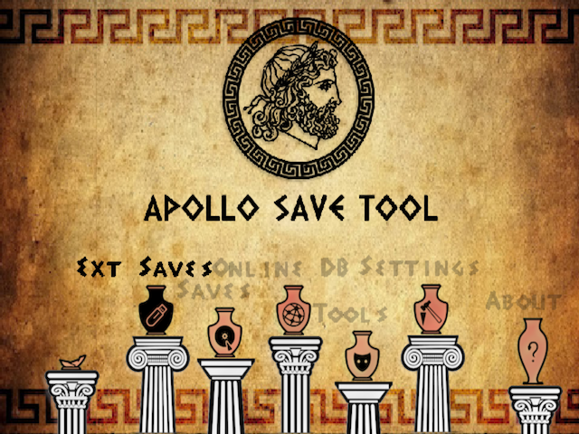

# Apollo Save Tool (PS2)

[![Downloads][img_downloads]][app_downloads] [![Release][img_latest]][app_latest] [![License][img_license]][app_license]
[](https://github.com/bucanero/apollo-ps2/actions/workflows/build.yml)
[](https://x.com/dparrino)

**Apollo Save Tool** is an application to manage save-game files on the PlayStation 2.

This homebrew app allows you to download, unlock, patch, and manage save-game files directly on your PS2.



**Comments, ideas, suggestions?** You can [contact me](https://github.com/bucanero/) on [Twitter](https://twitter.com/dparrino) and on [my website](http://www.bucanero.com.ar/).

# Features

* **Easy to use:** no advanced setup needed.
* **Standalone:** no computer required, everything happens on the PS2.
* **Automatic settings:** auto-detection of User settings.
* **Works without USB storage:** save patches are built into the app, and temporary files are kept in RAM when no USB drive is available.

## Save Management

* **Save files listing:** quick access to all the save files on Memory Cards and external devices (+ file details)
* **Save files patching:** complete support for Save Wizard and [Bruteforce Save Data](https://bruteforcesavedata.forumms.net/) cheat patches to enhance your save-games.
* **Hex editor:** edit save-game files byte by byte.
* **Save import/export:** allows the user export save files to `.PSU`, `.PSV`, `.CBS` formats, and import saves from other tools and consoles (`.PSU`, `.PSV`, `.CBS`, `.MAX`, `.XPS`, `.SPS` supported).
* **Save downloading:** easy access to an Online Database of save-game files to download straight to your PS2.
* **Delete saves:** remove save-games from Memory Cards and VMC images.

## Memory Card Management

* **Memory Card dump:** save a full image of a PS2 Memory Card (`.PS2` with ECC data, or raw `.VMC`) or a PS1 Memory Card (`.MCR`).
* **Memory Card restore:** write a PS2 Memory Card image back to a physical Memory Card.
* **Bulk save management:** copy or export selected (or all) saves at once.

## PS2 Virtual Memory Card Management

* **VMC saves management:** quick access to all save files on Virtual Memory Cards images.
  - Supported PS2 VMC formats: `.VM2`, `.CARD`, `.PS2`, `.VMC`, `.BIN`, `.MC2`, `.MCD`
  - Supports ECC and non-ECC images
* **Import PS2 saves:** import saves to VMCs from other systems and consoles (`.PSU`, `.PSV`, `.XPS`, `.CBS`, `.MAX`, `.SPS` supported).
* **Export PS2 saves:** allows the user export saves on VMC images to `.PSU` and `.PSV` formats

## PS1 Virtual Memory Card Management

* **VMC saves management:** quick access to all save files on Virtual Memory Cards images.
  - Supported PS1 VMC formats: `.VMP`, `.MCR`, `.VM1`, `.BIN`, `.VMC`, `.GME`, `.VGS`, `.SRM`, `.MCD`
* **VMC saves patching:** apply cheat patches and hex edit PS1 saves inside VMC images.
* **Import PS1 saves:** import saves to VMCs from other systems and consoles (`.MCS`, `.PSV`, `.PSX`, `.PS1`, `.MCB`, `.PDA` supported).
* **Export PS1 saves:** allows the user export saves on VMC images to `.MCS`/`.PSV`/`.PSX` formats.

## Network

* **Online Database:** browse and download save-games from the [Apollo Save Database](https://github.com/bucanero/apollo-saves) over the PS2 network adapter.
  - Requires a PS2 Network Adapter (or a Slim PS2) and a network with DHCP.
  - The network is only started when a download is needed.

# Download

Get the [latest version here][app_latest].

## Changelog

See the [latest changes here][changelog].

# Donations

My GitHub projects are open to a [sponsor program](https://patreon.com/dparrino). If you feel that my tools helped you in some way or you would like to support it, you can consider a [PayPal donation](https://www.paypal.me/bucanerodev).

# Setup instructions

No special setup is needed. Just download the latest `apollo-ps2.zip` package and install `APOLLO.ELF` on your PlayStation 2.
On first run, the application will detect and setup the required user settings.

Application settings are stored on `mc0:/APOLLO-99PS2/`, and application data (save patches, cache) on `mass:/APOLLO/`.

## Apollo disc

The Apollo disc image (`apollo-ps2.iso`) boots the application and includes an offline copy of the saves database and all the PS1/PS2 save patches, so these features work without a network connection or USB drive.

| Disc folder | Contents |
|-------------|----------|
| `APOLLO/PS2/`, `APOLLO/PS1/` | offline saves database ([apollo-saves](https://github.com/bucanero/apollo-saves)) |
| `APOLLO/PATCHES/` | `.savepatch` files ([apollo-patches](https://github.com/bucanero/apollo-patches)) |

## Data folders

### Save patches

Save patches (`.savepatch` files) are loaded from the first location where they're found:

1. `mass:/APOLLO/DATA/` (USB drive) - use it to add new or updated patches
2. `cdfs:/APOLLO/PATCHES/` (Apollo disc)
3. Built-in patches (included in the application)

### Saves database

The **Saves DB** menu uses the first database it finds: `cdfs:/APOLLO/` (Apollo disc), `mass:/APOLLO/`, `host:/APOLLO/`, and the [Online Database](https://github.com/bucanero/apollo-saves) otherwise.

### PS2

| PS2 | Folder |
|-----|--------|
| **External saves** | your saves must be stored on `<mass/host/cdfs>:/PS2/SAVEDATA/`. |
| **Memory Card saves** | save-games will be scanned from `mc0:/` and `mc1:/`. |
| **Virtual Memory Cards** | VMC images will be scanned from `<mass/host>:/VMC/` and `/PS2/VMC/`. |
| **Exported saves** | `.PSU`/`.CBS` files are saved to `/PS2/SAVEDATA/`, `.PSV` files to `/PS3/EXPORT/PSV/`. |
| **Memory Card images** | Memory Card dumps are saved to `/PS2/VMC/`. |

### PS1

| PS1 | Folder |
|-----|--------|
| **External saves** | your saves must be stored on `<mass/host/cdfs>:/PS1/SAVEDATA/`. |
| **Memory Card saves** | save-games will be scanned from `mc0:/` and `mc1:/`. |
| **Virtual Memory Cards** | VMC images will be scanned from `<mass/host>:/VMC/` , `/POPS/*`, and `/PS1/VMC/`. |
| **Memory Card images** | PS1 Memory Card dumps are saved to `/PS1/VMC/`. |

# Usage

Using the application is simple and straight-forward: 

 - Move <kbd>UP</kbd>/<kbd>DOWN</kbd> to select the save-game file you want to patch, and press . The patch screen will show the available fixes for the file. Select the patches and click `Apply`.
 - To view the item's details, press .
It will open the context menu on the screen. Press  to return to the list.
 - To reload the list, press .
 - To select saves for bulk operations, press <kbd>SELECT</kbd>.
 - Press <kbd>L1</kbd>/<kbd>L2</kbd> or <kbd>R1</kbd>/<kbd>R2</kbd> trigger buttons to move pages up or down.

# Online Database

The application also provides direct access to the [Apollo online database](https://github.com/bucanero/apollo-saves) of save-game files for PlayStation 2 and PlayStation 1 games.
These usually offer additional features such as completed games that can save you many hours of playing.

The Online Database project aims to [add more save-games](https://github.com/bucanero/apollo-saves/issues/new/choose) shared by the community.

# FAQs

 1. Where I can get a save-game for *XYZ game*?
    
    You can check sites like [Brewology.com](https://ps3.brewology.com/gamesaves/savedgames.php?page=savedgames&system=psp), and [GameFAQs](https://gamefaqs.gamespot.com/psp/). Also, searching on [Google](http://www.google.com) might help.
 1. I have a save-game file that I want to share. How can I upload it?
    
    If you have a save file that is not currently available on the Online Database and want to share it, please check [this link](https://github.com/bucanero/apollo-saves) for instructions.
 1. Why is it called **Apollo**?
    
    [Apollo](https://en.wikipedia.org/wiki/Apollo) was the twin brother of [Artemis](https://en.wikipedia.org/wiki/Artemis), goddess of the hunt. Since this project was born using the [Artemis-GUI](https://github.com/Dnawrkshp/ArtemisPS3/) codebase, I decided to respect that heritage by calling it Apollo.

# Credits

* [Bucanero](http://www.bucanero.com.ar/): [Project developer](https://github.com/bucanero)

## Acknowledgments

* [Dnawrkshp](https://github.com/Dnawrkshp/): [Artemis PS3](https://github.com/Dnawrkshp/ArtemisPS3)
* [Berion](https://www.psx-place.com/members/berion.1431/): GUI design
* [jimmikaelkael](https://github.com/jimmikaelkael): ps3mca tool
* [ShendoXT](https://github.com/ShendoXT): [MemcardRex](https://github.com/ShendoXT/memcardrex)
* [aldostools](https://aldostools.org/): [Bruteforce Save Data](https://bruteforcesavedata.forumms.net/)
* [PiNk/abyss](http://amigascne.org/abyss/pink/index.html): [Background music track](https://github.com/bucanero/apollo-ps2/blob/main/data/inside.ahx)

# Building

You need to have installed:

- [PS2 SDK](https://github.com/ps2dev/ps2sdk)
- [Apollo](https://github.com/bucanero/apollo-lib) library
- [cURL](https://github.com/ps2dev/ps2sdk-ports) library
- [PolarSSL](https://github.com/bucanero/oosdk_libraries/tree/master/polarssl-1.3.9) library
- [libZip](https://github.com/ps2dev/ps2sdk-ports) library
- [dbglogger](https://github.com/bucanero/dbglogger) library

The [GitHub Actions workflow](.github/workflows/build.yml) builds everything from scratch, and can be used as a reference.

Run `cmake -DCMAKE_TOOLCHAIN_FILE=$PS2DEV/ps2sdk/ps2dev.cmake . && make` to create a release build. Run `make packelf` to compress it to `APOLLO.ELF`, or `make release` to create the `apollo-ps2.zip` package (with the `APOLLO-99PS2` Memory Card folder).

To include the [latest save patches](https://github.com/bucanero/apollo-patches) in the application, point `APOLLO_PATCHES_DIR` to a local copy of the `apollo-patches` repository (the `PS1` and `PS2` folders are used):

```sh
cmake -DCMAKE_TOOLCHAIN_FILE=$PS2DEV/ps2sdk/ps2dev.cmake -DAPOLLO_PATCHES_DIR=/path/to/apollo-patches .
```

To build the Apollo disc image, run [`tools/make_iso.sh`](tools/make_iso.sh) (requires `xorriso`):

```sh
sh tools/make_iso.sh APOLLO.ELF /path/to/apollo-saves /path/to/apollo-patches apollo-ps2.iso
```

To enable debug logging, pass `-DAPOLLO_ENABLE_LOGGING=ON` argument to cmake. The application will print debug messages to the EE console (TTY), which can be read with [ps2client](https://github.com/ps2dev/ps2client) or on the [PCSX2](https://pcsx2.net/) log window. Debug builds load the application data from `host:/APOLLO/` instead of `mass:/APOLLO/`.

# License

[Apollo Save Tool](https://github.com/bucanero/apollo-ps2/) (PS2) - Copyright (C) 2020-2026 [Damian Parrino](https://twitter.com/dparrino)

This program is free software: you can redistribute it and/or modify
it under the terms of the [GNU General Public License][app_license] as published by
the Free Software Foundation, either version 3 of the License, or
(at your option) any later version.

[app_downloads]: https://github.com/bucanero/apollo-ps2/releases
[app_latest]: https://github.com/bucanero/apollo-ps2/releases/latest
[app_license]: https://github.com/bucanero/apollo-ps2/blob/main/LICENSE
[changelog]: https://github.com/bucanero/apollo-ps2/blob/main/CHANGELOG.md
[img_downloads]: https://img.shields.io/github/downloads/bucanero/apollo-ps2/total.svg?maxAge=3600
[img_latest]: https://img.shields.io/github/release/bucanero/apollo-ps2.svg?maxAge=3600
[img_license]: https://img.shields.io/github/license/bucanero/apollo-ps2.svg?maxAge=2592000
